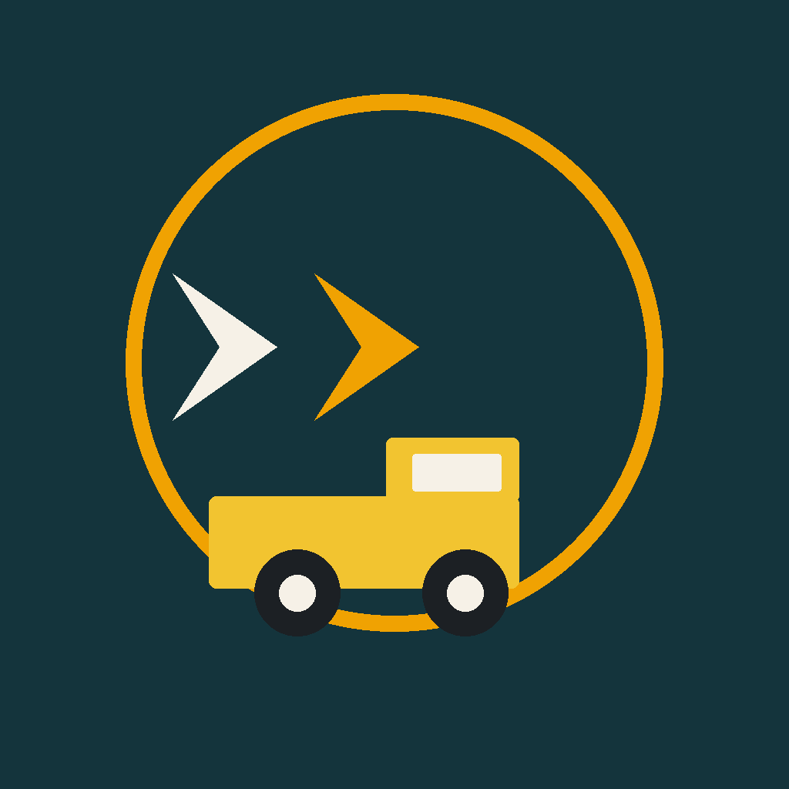
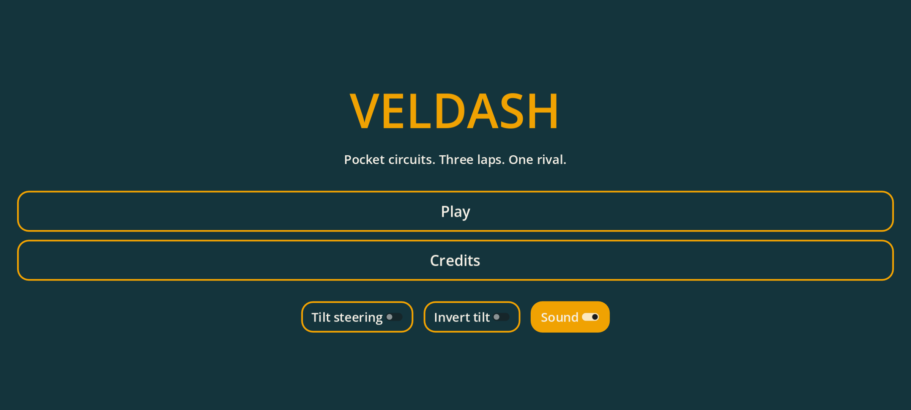
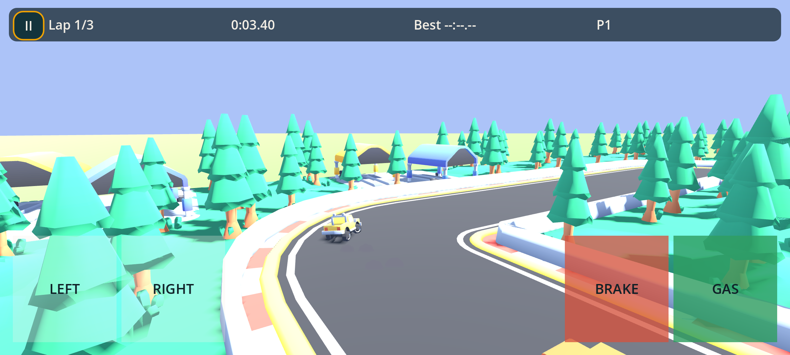

# Veldash

A pocket racing game for phones, built with Godot 4.7 from Kenney's Starter Kit Racing. Four circuits, a lap timer, saved best times, and one rival.

Bundle id (iOS and Android): `es.verkvest.veldash`

### Screenshots

 

### Play

Landscape. On a phone, steer with the left and right buttons and use the gas and brake buttons together. Tilt steering is optional (there is an invert switch, because devices disagree about which way is left). Keyboard still works: W accelerate, S brake, A D steer, Esc pause.

Best race time and best lap are stored on the device per circuit.

### Tracks

Circuits are built in code from the kit's GridMap pieces (`track-straight`, `track-corner`, `track-finish`, plus trees, tents, and a ramp off the racing line). The driving surface is a ground plane. Extra invisible walls keep the cars on the asphalt.

### Credits

See `THIRD_PARTY_LICENSES.md` and the in-game Credits screen. Code is MIT (Kenney). Models and sounds are CC0. The skid sound is by Landeplage (CC0). Godot Engine is MIT. The Veldash icon and splash are original.

### Export

- iOS: GitHub Actions workflow `ios-testflight` (Godot exports an Xcode project, then `xcodebuild` archives and uploads to TestFlight).
- Android: workflow `android-release` (release AAB and APK when keystore secrets are present, otherwise a debug-signed APK). Target SDK 36.
